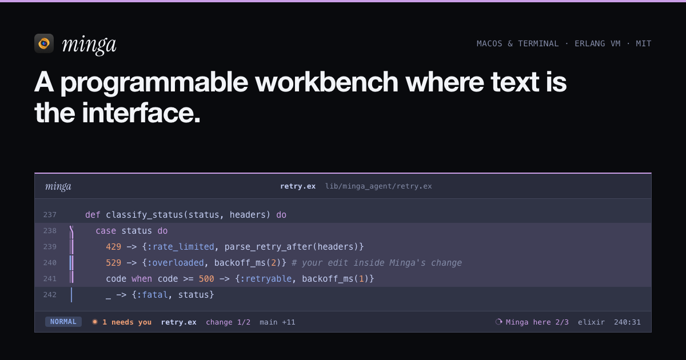

<p align="center">
  <a href="https://mingacode.dev">
    
  </a>
</p>

<p align="center">
  <a href="https://mingacode.dev"><strong>Website</strong></a> ·
  <a href="https://mingacode.dev/learn/"><strong>Interactive Learn Labs</strong></a> ·
  <a href="https://mingacode.dev/why-minga"><strong>Why Minga</strong></a> ·
  <a href="https://mingacode.dev/architecture"><strong>Architecture</strong></a> ·
  <a href="https://mingacode.dev/extending"><strong>Extending</strong></a> ·
  <a href="https://mingacode.dev/docs/"><strong>API Docs</strong></a>
</p>

# Minga

**A programmable workbench where text is the interface.**

Minga is a native macOS and terminal code editor built on Elixir and the Erlang VM (BEAM) for editing code alongside parallel AI agents. Your open files, language servers, extensions, MCP servers, and agent sessions each run in isolated BEAM processes behind thin native frontends: a Swift and Metal desktop app on macOS and a Go/Bubble Tea client in the terminal.

> **Status:** Pre-release, building toward v0.1.0 ([roadmap & release gates](#3542) · [ADR-0006](docs/adr/0006-the-spine.md) · [ADR-0004](docs/adr/0004-products-are-root-applets-over-a-fixed-engine.md)). Zero files are ever written to your Git repo; try it alongside your current editor with zero lock-in.

## Try it in 60 seconds

**macOS Desktop App (Apple Silicon, signed & notarized prerelease):**

```bash
brew install --cask jsmestad/minga/minga-mac && open -a Minga
```

**Terminal Client (Go / Bubble Tea):**

```bash
brew install jsmestad/minga/minga && minga .
```

**Linux Terminal Client (x86_64 and ARM64, glibc 2.39 or newer):**

```bash
yay -S minga-bin                                # Arch Linux, from the AUR
sudo apt install ./minga_<version>_amd64.deb    # Ubuntu 24.04+ and Debian 13+
sudo dnf install ./minga-<version>.x86_64.rpm   # Fedora
```

Download the `.deb` or `.rpm` for your architecture from the newest [release](https://github.com/jsmestad/minga/releases).

**Build from source (older Linux or Intel Mac):**

```bash
git clone https://github.com/jsmestad/minga.git && cd minga
asdf install && mix deps.get && mix compile && make native.support
bin/minga
```

Press `Space` in Normal mode to open mnemonic command menus (`SPC f f` find file, `SPC b b` switch buffer, `SPC s p` project search, `SPC a a` agent panel). Need step-by-step OS, client, and model provider setup? Open the [adaptive Quickstart runbook](https://mingacode.dev/getting-started) or read [docs/GETTING-STARTED.md](docs/GETTING-STARTED.md).

## Explore the interactive site

Before installing anything, you can test Minga's architecture, keybindings, and configuration model directly in the browser on [mingacode.dev](https://mingacode.dev):

| Page | What you can try live |
| --- | --- |
| **[Interactive Curriculum](https://mingacode.dev/learn/)** | Five hands-on browser labs covering quickstart setup, v0.1.0 keys, parallel agent co-authoring, Elixir config, and headless remote devboxes. |
| **[Why Minga](https://mingacode.dev/why-minga)** | Compare workspace screen budgets (`Typical AI IDE` vs. `Minga at Rest`) and filter honest migration tradeoffs for Cursor, VS Code, Zed, Neovim, Emacs, and tmux/Herdr. |
| **[Architecture](https://mingacode.dev/architecture)** | Fire real-time faults (`Hang LSP`, `Crash Parser`, `Crash :after_save`) while typing side-by-side against a single-loop editor, and step through 3-way staged overlay merges. |
| **[Extending Minga](https://mingacode.dev/extending)** | Pick a real task (`Format on save`, `Shell veto`, `LLM proxy & MCP`, `SQL migration`) and watch it graduate from `config.exs` to `minga_sdk` and v0.1.0 workflows. |
| **[Elixir Translator & Playground](https://mingacode.dev/learn/elixir)** | Translate Neovim Lua, Emacs Elisp, or VS Code JSON into `config.exs` with live theme previews (`Catppuccin Frappé`, `AstroDark`, `Doom One`, `One Light`). |

## Why the Erlang VM matters for code + agents

Single-threaded editors were built for one human typing sequentially in one file. When parallel agents stream responses, run shell tools, index repositories, and edit buffers alongside you, a shared event loop or single extension host stalls typing and loses state on crashes.

- **Preemptive scheduling and per-process GC.** Every open buffer, language server, save hook, extension, MCP server, and agent session runs in its own BEAM process with its own heap. Slow background indexing or token streams never freeze your cursor.
- **Buffer-aware staged agent edits.** Agent file tools require a revision token from a full read and stage edits in an isolated in-memory overlay with crash-safe draft persistence (`~/.local/share/minga/staged_drafts`), never blind writes onto disk. Review syntax-highlighted diffs and publish via three-way merge (`SPC a p`) or discard (`SPC a P`) without clobbering unsaved edits.
- **Native macOS and terminal parity.** Swift + Metal draws macOS, Go + Bubble Tea draws the terminal, and Zig runs 50 compiled tree-sitter grammars in a separate OS port. Both clients speak the same protocol over one core runtime.
- **Headless durability over SSH.** Run `minga --headless` on a remote Linux devbox and attach from macOS or any terminal (`minga attach ssh://`). Close your laptop lid while buffers, undo trees, and running agents stay alive.
- **Deterministic safety guardrails.** Configure `PreToolUse` shell veto hooks (JSON arguments on stdin, non-zero exit blocks execution), crash-isolated stdio MCP servers (prefixed `mcp_<server>__*`, default destructive approval), and corporate LLM gateways (`MingaAgent.InferenceRoute`).

## Configure and extend in plain Elixir

Your configuration at `~/.config/minga/config.exs` uses the same language as the editor core, validates option types cleanly, and reloads live with `SPC h r`:

```elixir
use Minga.Config

set :theme, :catppuccin_frappe
set :line_numbers, :hybrid
set :tab_width, 2

# Per-filetype overrides take a plain keyword list.
for_filetype :go, tab_width: 4, indent_with: :tabs

# Save hooks run asynchronously in separate BEAM tasks and never stall typing.
on :after_save, fn _buf, path ->
  if String.ends_with?(path, ".ex") do
    System.cmd("mix", ["format", path])
  end
end

# Wrap built-in commands with :before, :after, :around, or :override advice.
advise :after, :save, fn state ->
  Minga.API.message("Saved")
  state
end
```

Graduate to supervised Hex, Git, or local path packages with `minga_sdk`, custom tree-sitter grammars compiled on demand, and desktop CUA shortcuts (`set :editing_model, :cua`).

## Documentation map

- **Start here:** [Getting Started](docs/GETTING-STARTED.md) · [Configuration](docs/CONFIGURATION.md) · [Projects](docs/PROJECTS.md)
- **Agent runtime:** [Model Selection](docs/AGENT-MODEL-SELECTION.md) · [Buffer-Aware Agents](docs/BUFFER-AWARE-AGENTS.md) · [Session Recovery](docs/SESSION-RECOVERY.md) · [Remote Agents](docs/REMOTE_AGENTS.md) · [Hooks](docs/HOOKS.md) · [MCP Servers](docs/MCP.md)
- **Extending Minga:** [Extension API](docs/EXTENSION_API.md) · [Keymap Scopes](docs/KEYMAP-SCOPES.md) · [Agentic View Keymap](docs/AGENTIC-KEYMAP.md)
- **Architecture & protocols:** [Architecture](docs/ARCHITECTURE.md) · [Port Protocol](docs/PROTOCOL.md) · [Semantic UI Protocol](docs/GUI_PROTOCOL.md) · [Go TUI Renderer](docs/CHARM_TUI.md) · [Architecture Decisions (ADRs)](https://github.com/jsmestad/minga/tree/main/docs/adr)
- **Contributing:** [Contributing](CONTRIBUTING.md) · [Automation IPC](docs/AUTOMATION-IPC.md) · [Releasing](docs/RELEASING.md)

## License & acknowledgements

MIT licensed. Thank you to [Henrik Lissner](https://github.com/hlissner) and all contributors to [Doom Emacs](https://github.com/doomemacs/doomemacs), whose mnemonic leader-key UX inspired Minga's command grammar.

---

*Created by [Justin Smestad](https://evalcode.com). Built in Colorado.*
