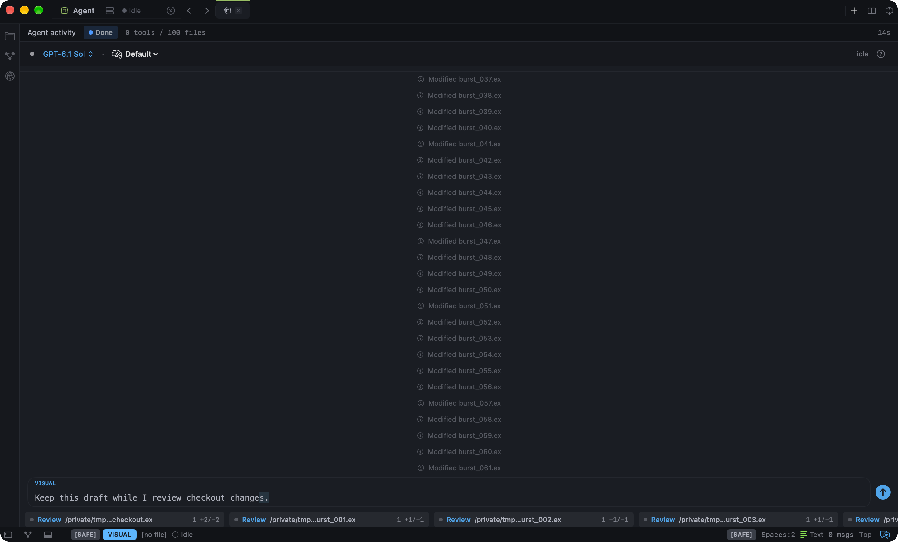
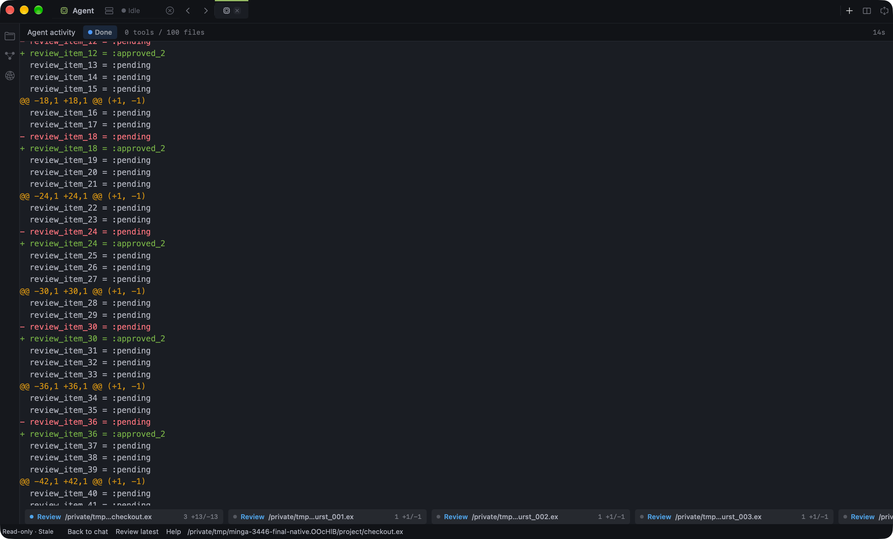

# Agentic View Keymap

The agentic view (`SPC a a`) is a full-screen OpenCode-style interface for interacting with AI agents. It follows Doom Emacs conventions for read-only special buffers: vim navigation motions are preserved, editing keys are repurposed for contextual actions, and multi-key sequences use standard vim prefixes.

## Architecture

Agent scope keybindings are declared as trie data in `Minga.Keymap.Scope.Agent` and resolved through the [keymap scope system](KEYMAP-SCOPES.md). The scope module defines separate tries for normal mode (navigation) and insert mode (input focused), plus shared bindings that apply in both.

When the agentic view is active, shell overlay handlers run first, then dedicated surface and sub-state handlers can consume input before `MingaEditor.Input.Scoped` resolves remaining agent scope bindings. Tool approval, diff review, and @-mention completion are separate handlers before trie lookup. The `?` help overlay content comes from `Scope.Agent.help_groups/1`.

The agent side panel (`SPC a a`) uses the same input handling for its chat input field, but navigation mode delegates to the vim mode FSM with the agent buffer for full vim navigation of chat content.

The agent does not own an interaction-level handler stack. Agent scope bindings live in `Minga.Keymap.Scope.Agent` and are resolved by `MingaEditor.Input.Scoped`; dedicated agent sub-state, navigation, panel, and mouse handlers remain separate entries in the shell's surface handler list. Users will be able to customize these bindings via the config system in phase 2 ([#215](https://github.com/jsmestad/minga/issues/215)).

See `Minga.Keymap.Scope` for the behaviour contract, `MingaEditor.Input.Scoped` for the dispatch logic, and [Keymap Scopes](KEYMAP-SCOPES.md) for the full architecture.

## Design Principles

1. **Sacred vim motions stay.** j/k, gg/G, Ctrl-d/u, /, n/N work exactly as a vim user expects.
2. **Editing keys are repurposed.** i/a focus the input (semantic parallel to "enter insert mode"). y copies structured content. q/Esc returns to the editor context for the same workspace.
3. **Standard prefixes for multi-key sequences.** `z` for all-block collapse toggling, `]`/`[` for next/prev code-block or diff-hunk navigation, `g` for go-to actions.
4. **SPC leader always works.** In navigation mode, SPC delegates to the mode FSM so leader sequences and which-key popups function normally. Once a leader sequence, an operator, or the describe-key prompt (`SPC h k`) is pending, every key goes to it, so `SPC h k q` describes `q` instead of closing the chat.
5. **The command line works, and nothing else leaks.** `:` opens the command line, so `:w`, `:qa`, and `:model` work from the chat. While the command line, search, or eval prompt is open, every key goes to it. Every other key the chat does not bind is ignored. It never edits, or moves focus to, the file buffer behind the chat.

The chat and the file viewer share one rule for unbound keys: from navigation mode, only SPC, `:`, `/`, `n`, and `N` reach the mode FSM. Eval opens from the leader with `SPC ;`. The rules for pending sequences and open prompts also cover the agent side panel (`SPC a a`), so `:qa` typed from the side panel types `qa` instead of `q` closing the split. Tool approval and diff review keys (`y`, `n`, `a`, `x`, and so on) do not act while a command line or key sequence owns the key, so `:x` never rejects a hunk.

### CUA editing model

The same rule holds in CUA mode. The chat and the file viewer do not edit files, so a CUA editing shortcut that reaches them as a key, such as an undo or paste chord from the terminal, is ignored instead of changing the file buffer behind the chat. Switch to the file to undo there.

On macOS, Cmd+S, Cmd+Z, Cmd+X, Cmd+C, and Cmd+V are menu shortcuts. The menu sends the command itself, not a key, so this rule does not filter them: Cmd+S still saves through the menu, and each of these commands acts on the active buffer exactly as it does from any other surface.

## Chat Navigation Mode

The default mode when the agentic view is open and the input is not focused.

### Scrolling

| Key | Action |
|-----|--------|
| `j` | Scroll down 1 line |
| `k` | Scroll up 1 line |
| `Ctrl-d` | Scroll down half page |
| `Ctrl-u` | Scroll up half page |
| `gg` | Scroll to top |
| `G` | Scroll to bottom |

### Fold / Collapse (z prefix)

| Key | Action |
|-----|--------|
| `zA` | Toggle all collapsible tool-call and thinking blocks |

Migration notice: the old built-in at-cursor, directional collapse/expand, message navigation, and tool-call navigation command atoms and keys are removed without aliases. Use `zA` / `:agent_toggle_all_collapse` for the built-in all-toggle, or define a user or extension command for custom behavior.

### Bracket Navigation (]/[ prefix)

| Key | Action |
|-----|--------|
| `]c` / `[c` | Next / previous diff hunk (when diff review is active) or code block |

### Go-to (g prefix)

| Key | Action |
|-----|--------|
| `gg` | Go to top (standard vim) |
| `gf` | Open code block at cursor in editor buffer |

### Copy / Diff Review

Choose **Review** on a changed file to inspect it. Agent writes record changes without selecting another file or moving you out of the draft. The timeline keeps the same space before and after the first write, so incoming files do not move Send or the Review controls.

For example, if you are reviewing `checkout.ex` when the agent changes `shipping.ex`, your selected file and reading position stay unchanged. If the agent changes `checkout.ex` again, the old review stays visible with a **Stale** label. Choose **Review latest** to load the new revision before accepting or rejecting hunks. **Back to chat** resumes the retained draft, including its editing mode and selection.

These full-workspace captures use controlled file events with provider requests disabled.

While the current review is selected, these keys apply:

| Key | Normal | Diff Review Active |
|-----|--------|--------------------|
| `y` | Copy code block at cursor | Accept current hunk |
| `Y` | Copy full message at cursor | Accept all remaining hunks |
| `x` | (unused) | Reject current hunk (reverts on disk) |
| `X` | (unused) | Reject all remaining hunks |

When all hunks are resolved (accepted or rejected), the viewer returns to normal file view.

In CUA mode (`set :editing_model, :cua`) the review uses chords instead of letters, so nothing you press while reviewing can be mistaken for typing. They apply only while the review has focus; with the composer focused, the same chords keep their composer meaning. In the macOS app, use Cmd; in the terminal, which cannot send Cmd, use Ctrl. Both work in the macOS app.

| Key (macOS app) | Key (terminal) | Diff Review action |
|-----------------|----------------|--------------------|
| `Alt+Down` / `F7` | `Alt+Down` | Next hunk or conflict |
| `Alt+Up` / `Shift+F7` | `Alt+Up` | Previous hunk or conflict |
| `Cmd+Enter` | `Ctrl+Enter` | Accept current hunk (**Use Agent version**) |
| `Cmd+Backspace` | `Ctrl+Backspace` | Reject current hunk (**Keep mine**) |
| `Cmd+Shift+Enter` | `Ctrl+Shift+Enter` | Accept all remaining hunks |
| `Cmd+Shift+Backspace` | `Ctrl+Shift+Backspace` | Reject all remaining hunks |

`Ctrl+Enter` and `Ctrl+Backspace` need a terminal that reports modified Enter and Backspace (the Kitty keyboard protocol, as in Ghostty, kitty and WezTerm). Elsewhere they arrive as plain Enter and Backspace, which never decide a hunk. The Help overlay (`?`) and the **Keep mine** and **Use Agent version** buttons always show the keys of your editing model.

If a staged agent edit overlaps your own changes, Review shows both versions. Choose **Keep mine** (`x` in Vim) or **Use Agent version** (`y` in Vim) for the selected conflict. Minga applies the combined result only after every conflict has a choice and the source revisions still match. If either source changes, **Review latest** reloads the conflict before you can choose again.

### Publishing Approved Edits

Approving an edit lets the agent make it, but it does not write the file yet. An agent session you start from the editor works in an isolated copy of the project, so an approved edit is staged: the agent sees it, **Review files** lists it, and the file on disk and your open buffer still show the old text. You decide when staged edits land.

When the agent finishes a turn with staged edits, a notification says, for example, "1 agent-edited file is not on disk" and offers **Publish** and **Discard**. Click either one, or use the keys below from the editor or the agent view.

| Key | Action |
|-----|--------|
| `SPC a p` | Publish or discard agent edits, in one prompt |

Publish writes the staged files to disk and merges them into any open buffer, then the agent keeps working in a fresh staging area. The agent itself confirms it is between turns before anything is published or discarded; if it is still working, or its staging area cannot be renewed, nothing changes and Minga says why. If you changed the same lines yourself in the meantime, Minga keeps both versions and opens the conflict review instead of overwriting your work. Discard drops the staged edits and leaves disk and buffers untouched. Both wait until the agent turn finishes; while it runs, Minga says so and changes nothing.

Staged edits are never lost silently. Every ordinary way out stops and shows the same Publish and Discard choice: `:q` and `:wq` when they would close the last tab, `:qa`, `:wqa`, the quit confirmation prompt, and quitting the macOS app. `:wq` and `:wqa` still save your buffers first. The force and abort quits, `:q!` (when it would exit), `:qa!` and `:cq`, quit and discard staged agent edits on purpose. Quitting is never blocked when nothing is staged.

Staged edits also survive a crash or restart. If the editor restarts on its own (for example after the watchdog recovers a frozen editor), the staged edits are still running and come back to their workspace. If Minga itself exits without a publish or discard, such as after a crash, the next start for the same project restores them: `*Messages*` says how many files were restored, and the same Publish and Discard notification appears. Minga saves each staged edit together with the version of the file it was made against. If that file changed on disk while Minga was not running, `*Messages*` says so, and publishing merges the two or keeps the edit staged as a conflict; it never overwrites your change. A saved edit that cannot be restored is named in `*Messages*` as lost.

The saved copies are private to your user (`~/.local/share/minga/staged_drafts`, or under `$XDG_DATA_HOME`), and Minga deletes them when you publish or discard.

### Input

| Key | Action |
|-----|--------|
| `i` / `a` | Focus the input field |
| `Enter` | Focus the input field |

### Agent Questions

When the Agent pauses to ask which output to keep, choose **Answer question**. Choose a listed answer, choose **Type an answer…** to enter your own, or select **Cancel question** to resume the turn without supplying an answer. Escape closes the picker without answering. Your composer draft stays separate.

If the question does not fit in one preview, choose **Next question page** or **Previous question page**. Paging changes only the preview, not the pending answer or the draft.

Choose **Inspect choice** when a label is too long for the list. Read its pages before choosing **Use choice**. **Back to question** returns without answering.

An answer gives the Agent information, not permission. If the Agent later needs approval for a tool, it asks separately. See [Remote Agents](REMOTE_AGENTS.md#answer-a-remote-agent-question) for disconnect and restart behavior.

### Tool Approval

An approval can arrive while you are writing the next message. Keep typing: the composer retains its focus, selection, and text composition. The approval card remains available without turning ordinary draft text into a decision.

Use the card's buttons directly, or leave the composer to use its shortcuts. In Vim INSERT mode, press `Esc` once to enter NORMAL mode, then again to leave prompt editing. With the composer unfocused, these unmodified keys resolve the displayed tool request:

| Key | Action |
|-----|--------|
| `y` / `Enter` | Approve this invocation once |
| `a` | Trust this named tool for the current session |
| `t` | Trust this named tool for the current turn |
| `n` / `Esc` | Deny this invocation |

Trust applies to the named tool, not every tool the agent might use. Turn trust expires before the next prompt. Modified shortcuts, such as `Ctrl-a`, are not approval decisions.

Each card identifies its original conversation and tool request. A stale, duplicate, or unauthorized activation cannot approve a replacement request or remove its card; Minga explains the refusal instead. A completed or expired tool wait retires its card, even while another call in the same request is still running. It cannot grant trust afterward.

Entering plan mode, losing the provider, resetting the conversation, or restoring another conversation also retires the outgoing approval. Its controls cannot transfer to the replacement request or conversation.

While a tool waits for a decision, the workspace shows **Awaiting approval**, not Running. Stop remains available. Denied, Cancelled, and Expired are distinct outcomes, not generic tool errors; their cards do not count the approval wait as execution time.

Stopping a tool already admitted for execution may leave its outcome indeterminate. Minga retains captured output and does not claim that Stop rolled back its effects.

The Stop button applies only to the turn shown in the workspace. If that turn has already ended, Minga leaves a newer turn and its pending prompts alone.

The header's Help and model controls work without typing commands into your draft, including when the file tree has focus. While Help is open, `Esc` or `?` closes Help before changing the composer's mode or focus. Typing, Enter, and paste cannot edit or submit the covered draft.

In the terminal, use Up/Down, Page Up/Page Down, Home, or End to navigate long Help. The mouse wheel also scrolls Help from the details rail; the composer keeps its own scrolling. Native transcript controls behind Help do not accept pointer or accessibility activation.

See [Agent tool approval](CONFIGURATION.md#agent-tool-approval) for how to configure which tools require approval.

### Session

| Key | Action |
|-----|--------|
| `s` | Open session switcher |
| `SPC a S h` | Browse session history (load past conversations) |
| `SPC a r` | Pending reviews |
| `SPC a p` | Publish or discard agent edits, in one prompt |
| `SPC a ?` | Ask about the current line or visual selection inline |
| `SPC a e` | Rewrite the visual selection inline |
| `SPC a S m` | Pick agent model |

### Panel Management

| Key | Action |
|-----|--------|
| `Tab` | In Normal mode, switch between chat and the retained Review, including from the focused draft |
| `}` | Grow chat panel width (+5%) |
| `{` | Shrink chat panel width (-5%) |
| `=` | Reset panel split to default (65/35) |

### View

| Key | Action |
|-----|--------|
| `q` | Return to the recorded editor context for this workspace |
| `Esc` | Dismiss transient UI, then return to the recorded editor context |
| `?` | Show help overlay |

### Search

| Key | Action |
|-----|--------|
| `/` | Search chat messages |
| `n` | Next search match |
| `N` | Previous search match |

### Leader (SPC)

| Key | Action |
|-----|--------|
| `SPC a a` | Toggle agentic view (return to editor context) |
| `SPC a n` | New local agent workspace |
| `SPC a s` | Stop / abort agent |
| `SPC a ?` | Ask about the current line or visual selection inline |
| `SPC a e` | Rewrite the visual selection inline |
| `SPC a r` | Pending reviews |
| `SPC a W` / `SPC a A` | Why is this line like this? / Code autobiography |
| `SPC a q q` / `SPC a q f` | Queue: inspect queued inputs / queue the composer input as a follow-up |
| `SPC a x b` / `SPC a x f` / `SPC a x d` / `SPC a x l` | Context: attach this buffer, a project file or this file's diagnostics, or list draft attachments |
| `SPC a S l` | Session: pick local or remote agent workspace |
| `SPC a S m` / `SPC a S t` | Session: pick agent model / thinking level |
| `SPC a S h` / `SPC a S R` / `SPC a S s` | Session: resume, rename or stop the session |

## Chat Input Mode

Active when the input field is focused (after pressing `i`, `a`, or `Enter`).

| Key | Action |
|-----|--------|
| Printable chars | Type into input |
| `Enter` | Submit prompt |
| `Ctrl-c` | Abort an active turn; otherwise return to Normal mode |
| `Esc` | Return to input Normal mode; press again to leave the input |
| `Ctrl-d` | Scroll chat down half page |
| `Ctrl-u` | Scroll chat up half page |
| `SPC` | Types a space (not leader key) |
| `Left` / `Right` | Move the draft cursor without leaving Insert mode |
| `Up` / `Down` | Move within the draft or recall prompt history at its boundary |

In Vim Insert mode, Shift+arrow keeps Vim movement semantics rather than starting a CUA selection. Press `Esc`, then `v`, to select with Vim motions. Arrow navigation never inserts the key's private-use codepoint into the draft, and returning from Review keeps the same draft and editing mode.

## File Viewer Navigation

Active when the file viewer panel has focus (after pressing `Tab`).

| Key | Action |
|-----|--------|
| `j` / `k` | Scroll down / up 1 line |
| `Ctrl-d` / `Ctrl-u` | Scroll half page |
| `gg` / `G` | Top / bottom |
| `Tab` | Switch focus back to chat |
| `q` / `Esc` | Return to editor context |
| `}` / `{` | Grow / shrink chat panel |
| `=` | Reset panel split |

All `z`, `]`/`[`, and `g` prefixes also work in the file viewer.

## Reserved Keys (not yet assigned)

These vim keys are reserved for their standard meanings and are not repurposed, even though they have no current function in the read-only agentic view:

- `h` / `l` (left/right movement)
- `w` / `b` / `e` / `W` / `B` / `E` (word motions)
- `f` / `F` / `t` / `T` (find/till char)
- `H` / `M` / `L` (screen top/middle/bottom)
- `d` / `c` / `x` / `r` / `R` (editing operators)
- `p` / `P` (paste)

## Doom Precedents

The key repurposing follows established Doom Emacs / Evil conventions for read-only special buffers:

- **magit:** `s` = stage, `o` = toggle section, `q` = close, `Tab` = toggle collapse
- **org-agenda:** `q` = close, various single keys for mode-specific actions
- **which-key:** SPC leader popups work in all modes

The principle: in a read-only buffer, editing keys have no natural meaning, so they can be repurposed for contextual actions without violating user expectations.
