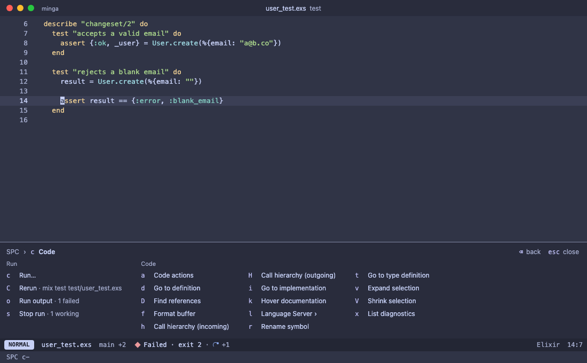
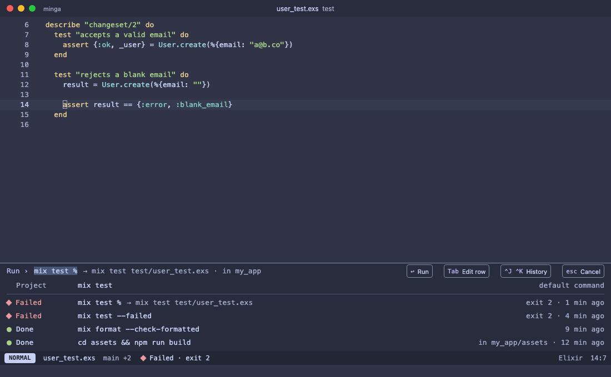
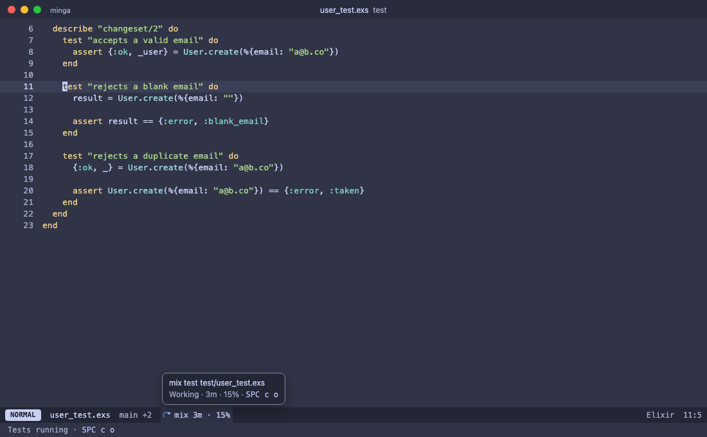
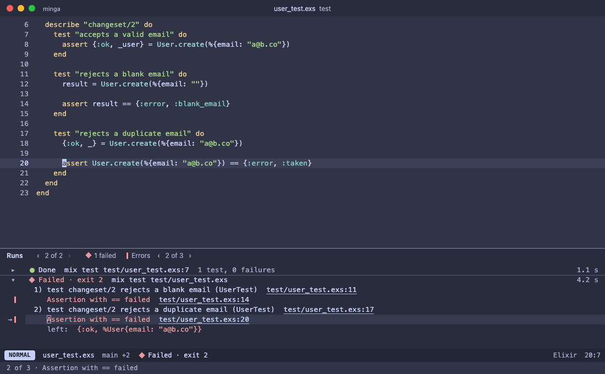
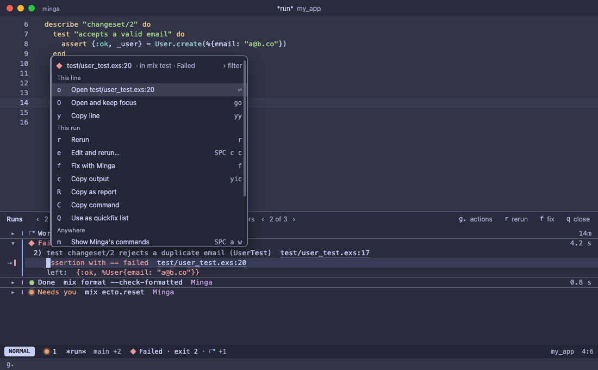
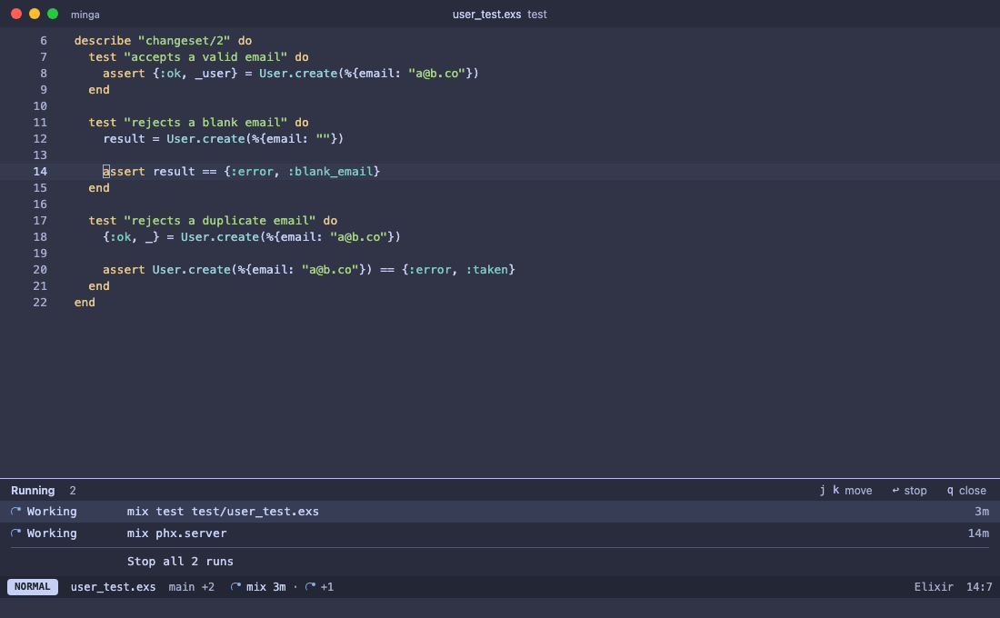
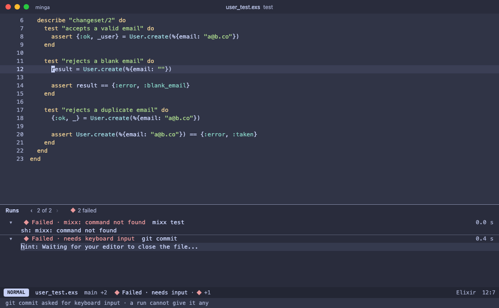
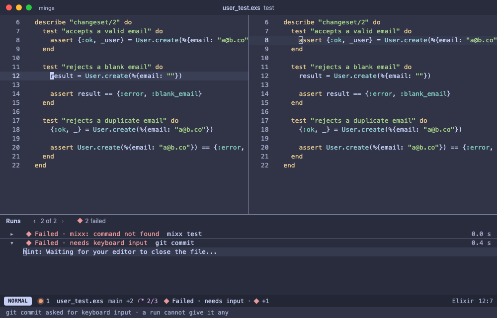
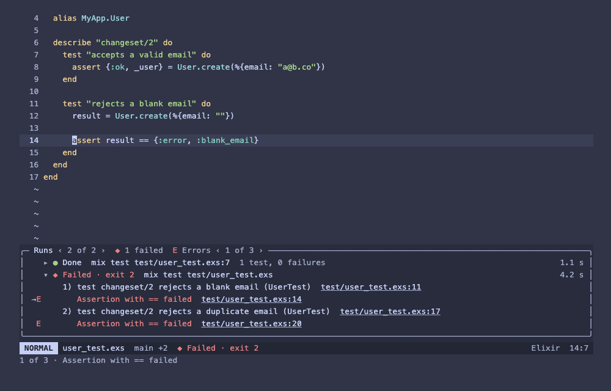

# Runs and the run drawer

A run is a command you start from the editor and do not type into: `:!make`, the project's tests, a build. This page says where a run's output goes, what you can do with it, and what Minga does when one fails. The interactive shell is a different surface, covered in [terminal.md](terminal.md).

**Status:** reviewed, not built. The decisions are [ADR-0010](../adr/0010-runs.md) and [ADR-0011](../adr/0011-buffer-drawers.md), both Proposed. The plan is in [the runs workstream](https://github.com/jsmestad/minga/blob/main/docs/workstreams/runs.md). Today `:!` and the test commands write into a plain buffer through `Minga.CommandOutput`.

The design went through seven review rounds with a Minga UX specialist, a macOS designer and a Doom/Neovim power user, and one architecture review. Two decisions were the owner's: a failed check opens the run drawer by default, and no "current run" is stored.

## Decision

Minga has two kinds of command surface, split by one question: does the command need a terminal?

- **A run** is a non-interactive command with a known command line: `:!cmd`, a test command, a project command, and every command Minga's agent runs. The BEAM owns a run record for it.
- **A terminal** (`SPC o t`, [ADR-0008](../adr/0008-terminal-engine.md), not shipped) is an interactive shell in a PTY.

Each project has one run buffer, `*run*`: a read-only special buffer of run blocks, one per run, in start order. Approvals are pending blocks in it. `*minga-shell*` as a separate buffer is withdrawn.

`*run*` is a buffer, not a list view. The editor renderer draws it in uniform rows at the buffer's row pitch, with the Vim cursor, like any buffer (ADR-0001). Nothing in it has its own row height.

Documents this changes when it is built: `docs/design/terminal.md`, ADR-0008, `docs/design/keys.md`, `docs/design/surfaces.md` (modeline order, switcher sections, which-key sections), `docs/design/marks.md` (strand in a block buffer, entry marks), `docs/design/themes.md` (Working takes its author's role; new roles in section 12), ADR-0006 decision 2 (a tenth segment).

## 1. Keys from anywhere

All are free in `lib/minga/keymap/defaults.ex` today. Doom meanings were read from Doom's own bindings file (`doomemacs/modules`, `modules/config/default/+evil-bindings.el`, HEAD on 2026-11-27).

| Key | Action | Doom | tsv row |
|---|---|---|---|
| `SPC c c` | Run: the Run prompt (section 9) | Compile | matches |
| `SPC c C` | Rerun | Recompile | matches |
| `SPC p c` | Run the project's default command | Compile in project | matches |
| `SPC p T`, `SPC m t …` | Test commands, unchanged; `SPC m t r` reruns the last test | Test project | matches (shipped) |
| `SPC c o` | Run output, three states: hidden → show and focus; visible, not focused → focus; focused → close and return focus | not bound | new |
| `SPC c s` | Stop a run of yours | Send to REPL | diverges |
| `SPC ~` | Show or hide the last drawer without moving focus | Toggle last popup | matches |
| `SPC m t o` | Show test output: becomes an alias of `SPC c o` | n/a | alias |
| `SPC w p` | Previous window | evil's window map; `p` not verified | to verify |
| `]q` / `[q` | Next / previous error, from any window | bound outside that file | to verify |

- `:!cmd` is a run; `:{range}!cmd` is a synchronous filter; `:r !cmd` inserts.
- `SPC c C` reruns the last run you started with a run key, a test key, the Run prompt or `r`. A `:!` command is never its target, so a reflex rerun cannot repeat `:!git push`. The echo area names what it reran.
- `SPC c c` is one command, "open the Run prompt". Inside a block of `*run*` it prefills that block's command; anywhere else it prefills the last command. "The last command" is the same target as `SPC c C`: a `:!` command appears in the history rows but is never the prefill, so `SPC c c ↩` cannot repeat `:!git push` either.
- `SPC ~`: the last drawer is the last non-prompt drawer you had open; a drawer closed with `q` is still the last drawer and comes back unfocused at its old scroll position. Transient drawers (the switcher, the Run prompt, the stop list) are never the last drawer. A drawer shown with `SPC ~` counts as opened by you. Hiding with `SPC ~` does not mark a failed run as seen. With no drawer to show, the echo area says "No drawer to show". On layouts where `~` is a dead key, the tsv records an alias.
- `SPC t p` (Toggle bottom panel, shipped) keeps its meaning for the Messages panel until that panel becomes a Spine drawer; then `SPC ~` covers it and `SPC t p` is retired in that change, not this one.
- ⌘. stops, in order: the running run under the cursor in focused `*run*`; your newest running run when `*run*` is focused; otherwise Minga's turn. The macOS menu bar has one Stop item that carries ⌘. and names its target.

## 2. Navigation map

| From | To | Key | Click |
|---|---|---|---|
| A file | The run drawer, focused | `SPC c o` | The run segment; Code › Run Output |
| A file | The drawer shown or hidden, focus unchanged | `SPC ~` | Drag the divider; hover the header, then `q close` |
| A file | The first / next / previous error | `]q`, `[q`, `:cfirst`, `:cc N` | The drawer's error stepper |
| A file | The next error in another file | `:cnfile` / `:cpfile` | The error stepper |
| A file | Any run by name | `SPC ,` switcher, section "Runs" | same rows |
| The drawer | The window you came from, drawer stays | `↩` on a link or error; `SPC w p` | Click in the file |
| The drawer | The window you came from, drawer closes | `q`, `esc`, `SPC c o`, ⌘W | `q close` in the header; drag the divider past its minimum |
| After a jump | Where you were | `⌃O` | ⌘[ |
| A block | Next / previous block | `]]` / `[[` | The run stepper |
| A block | The oldest block in a state | `SPC ,` › Runs, where typing a state word filters (search cannot find a state: it is not buffer text) | The header's state counts |
| An error or link | The file at that line, focus moves | `↩` | ⌘-click; the top act-menu row |
| An error or link | The file at that line, focus stays | `go`; `]q` / `[q` inside the drawer | none |
| A block | Its act menu | `g.`, or `↩` on the block header | Right-click in the block; its state shape |
| A pending approval | The answer prompt | `↩` on the block | Its Needs-you shape |
| A block | Folded / unfolded | `za`, `zM`, `zR` | Its chevron; double-click the header row |
| A held view | The newest output | `G` | "↓ N new lines" at the bottom edge |
| Anywhere | Minga's commands | `SPC a w`: `*run*` in a split, scrolled to Minga's newest block, your blocks folded | Act menu › Show Minga's commands; the Minga menu |
| The drawer | Full height | `SPC ,` → `*run*` | same |

`]q` from a file moves the drawer's cursor to that entry when the drawer is visible. `↩` on an entry sets the list index. `]q` and `[q` always echo "N of M · message"; the owning run is prefixed only when it is not the run the segment names. The first `]q` or `[q` after the list changes owner always prefixes the owning run, so the jump explains itself and `:colder` is the way back.

## 3. What each key targets

Three derived rules.

- **`SPC c C`**: the last run you started, never a `:!` (section 1).
- **The run segment and the drawer's open position**: attention order among your runs. Your most recently failed run, else your oldest running run, else your newest run. While an output run you started is running, or until you focus the drawer, the drawer's open position is that run. With no run of yours to name, the segment names Minga's failed run in the minga role ("Minga's run failed · exit 1").
- **`]q`**: the current quickfix list and nothing else.

No current run is stored. Each target is derived from the run records (author, how started, state, superseded-by, seen) and the quickfix stack (each list's index, and the list last stepped).

Which run takes the quickfix list:

- A run you started that ends non-zero with at least one entry takes the list. `kind` does not matter here; it decides only whether the drawer opens and whether a Done block folds.
- It is blocked while the list you last stepped still has unvisited entries after its index, or while the current list belongs to a failed run of yours that you have not seen. The echo line then names the way: "Tests failed · 3 errors · :cnewer".
- Seen: a failed run is seen when its header row has been inside the drawer's viewport for 2 s while Minga was frontmost, or when you stepped to it with `]]`, `]q` or a stepper.
- A run with no entries never changes which list is current.
- **Supersede.** A run supersedes earlier runs of the same command and cwd. A superseded run does not count in attention order, and its quickfix list is replaced in place by the new run's list, including an empty one. `]q` on an empty list says "No errors · mix test passed".
- When `]q` steps a list that is not the run the segment names, the echo line names the owner: "mix credo · 2 of 4 · message".
- An entry binds to a buffer position when its file is first opened after the run, and shifts with later edits. If the file on disk is newer than the run's start at that moment, `]q` lands on the recorded line and the echo line adds "file changed since the run". An entry whose line was deleted moves to the nearest remaining line.

**Only a run you started acts by itself**: opens the drawer, takes the quickfix list, or (while you have a run to name) names the segment. `r` on one of Minga's blocks starts a new block authored by you.

## 4. Concurrency and retention

- A run is keyed by command and cwd. Rerunning the same key stops the earlier run of that key. Nothing else stops a run implicitly.
- Your keys never stop a run Minga started.
- Caps are per run (10,000 lines, 8 MB, 4,000 columns per line). A run past its line cap keeps its first 2,000 and last 8,000 lines, with one marker between them that says how many lines it dropped. The marker is a virtual row (a block decoration), not buffer text, so `yic` and search do not see it. Entries are extracted before the cut and survive it with their messages, up to 1,000 per run. Fix with Minga attaches the retained output and every entry. The buffer keeps the last 5 finished runs per author, and fewer when retained lines would pass 50,000 (the oldest finished run goes first), so `*run*` stays inside the resident store's row ceiling. A running run is never evicted.
- Run records and the open drawer are not restored on relaunch. Command history, the last command and the drawer's remembered height are. Quitting stops your running runs by process group. The quit prompt lists them ("mix phx.server · 14m") and says they stop.

## 5. Errors and the quickfix core

- Matchers belong to the run record: a table per filetype and per command, extensible in config, producing entries with severity and message.
- An entry's location is the deepest frame inside the project. The test head is a link on the same block, drawn as a link.
- The quickfix list core ships with this work: the list stack, `]q` / `[q`, `:cnext`, `:cprev`, `:cfirst`, `:clast`, `:cc N`, `:cnfile`, `:cpfile`, `:colder`, `:cnewer`, wrapping across files. A new list's index sits before its first entry. The quickfix drawer, `⌃Q` from pickers and `:cdo` stay in #4059.
- Watch mode: a command's matcher may declare a cycle-start pattern. Each cycle start replaces that run's list in place, resets its index and re-arms follow. Without a declared pattern, a running run never takes the list. A cycle is treated as a run for errors. A watch run takes the quickfix list at the first entry of a cycle, under the same blocking rule. From that entry until the next cycle start, the run counts as failed for attention order, the segment and the reveal, and its header reads "Working · 2 errors". A cycle start with no entries after it counts as a pass for self-close, and `]q` says "No errors · npm test".
- Progress: a matcher may supply a done count and a total. Only then does anything show progress.
- The generic matcher reads `path:line[:col]` and grouped output (a row that is an existing path, followed by `N:` rows, as `rg` prints on a terminal).
- A run with no declared cycle pattern treats a screen-clear sequence as a cycle start.

## 6. The run block

- Record: id, command, cwd, author, kind (`check` or `output`), how it was started (key, prompt, `:!`, hook, Minga), times, state, exit code, reason, range, entries, last-output time, progress, superseded-by.
- States use `marks.md` shapes and words only: Working, Done, Failed with its reason, Stopped, Needs you. A run's Working shape takes the role of its author. The Working shape is the `marks.md` orbit (an arc and a satellite), not a ring, so it differs from the hollow dot of Stopped without colour or motion.
- Block header: one buffer row. The fold chevron (`▸` folded, `▾` open) and the state shape are buttons one row tall and three cells wide, and the frontend extends each hit area to at least 24 pt where the font makes three cells narrower; `anatomy.md` records this exception to the 24 pt hit height for marks inside a buffer. The rule between blocks is a hairline on the top edge of the header row and adds no height. The header row's buffer text is the command and nothing else. The chevron, state shape, state word, reason, cwd, "Minga" and duration are drawn on that row as decorations and are not buffer text, so `yy` on a header yanks the command. Decorations in order: the state shape, three cells, a button that carries the run's id (the act-menu click); the state word and reason, inline before the command; cwd, "Minga" and the summary line, after the command; the duration, right-aligned with two cells of clearance and hidden when the command leaves no room. A long command is clipped at the right like any unwrapped line. Inside the buffer the Working shape is static; only the modeline's moves. Search and `:g` see buffer text only. "Copy as report" in the act menu yields `$ command`, the output, then the state line.
- Each block is one fold. A Done check starts folded and shows the runner's summary line after the command; when the runner prints none, its last non-empty line. Folds open by themselves for search hits, error jumps and `]]`.
- No dimming by age and no failure tint.
- SGR colour maps to theme roles; carriage returns fold; other escapes are dropped. A link at rest has a 1 pt underline in the muted role; hover gives the link role and the pointing hand.
- Nothing Minga says is buffer text. Explanations live in the block header's reason, the hover and the echo line, so `yic` copies only what the command printed.
- A run's stdout and stderr are a PTY; its stdin is `/dev/null`. A program that checks its input sees no terminal and skips its interactive mode (so `jest` and `vitest` watch mode run), and a read returns end of file. Only a program that opens the controlling terminal itself (the editor from `git commit`, `sudo`, `ssh`) ends as Failed. Changing terminal settings alone does not end a run.
- The PTY reports `TERM=xterm-256color` and a fixed size: the drawer's columns at run start (120 with no drawer) by 50 rows. It does not resize during the run.
- Environment: runs use the environment resolved from your login shell, the same one language servers use, so `:!mix` finds what your terminal finds. On top of it, a documented and config-extensible set: `PAGER`, `GIT_PAGER`, `MANPAGER`, `GH_PAGER` = `cat`; `BUILDKIT_PROGRESS=plain`; `CARGO_TERM_PROGRESS_WHEN=never`. So `:!git log` prints the whole log up to the caps.
- A line rewritten with a carriage return or cursor movement is one row that updates in place; its earlier states are not kept. The reason reads "needs keyboard input" and names no key; once the terminal ships, the echo line adds "· SPC o t".
- Reasons have a short form of at most 16 characters for the segment ("exit 2", "not found", "needs keyboard input" → "needs input") and a full form for the header and hover ("mix: command not found").
- Silence: a check that has printed output and then nothing for 60 s shows "no output 1m" in its block header and in the hover. An output run never shows it.

### Authorship

- Shown only when it distinguishes something. While every retained block is yours, the column is empty.
- The run buffer uses the code gutter's columns in the code gutter's order, with line numbers off: the sign column, then the 10 pt authorship column, then text. Both are always reserved.
- The authorship column: With both authors present, each block draws one 2 pt strand with rounded ends, in the you role or the minga role, from the top of its header row to the bottom of its last row. A folded block draws a 2 by 8 pt strand centred on its header row.
- The cursor-row tint starts after the gutter, at the text.
- It is a strand, not the twist ribbon. Minga's blocks also say "Minga". Hover: "Run by Minga · task: fix blank email" or "Run by you · SPC c C".

### Entry marks

The first columns are the code gutter's sign column and fold column, three cells together: the severity sign and `→` in the sign column on entry rows, the chevron in the fold column on header rows. Then the 10 pt authorship column. Each entry row carries the diagnostic severity sign from `marks.md`. The current quickfix entry has a `→` in the accent role before its sign. `▸` and `▾` mean folded and open and nothing else.

## 7. The drawer

- Header (chrome, drawn at 24 pt at every row pitch; for the Room test the frontend reports the drawer's chrome cost as a whole number of rows, rounded up): `Runs`, a run stepper `‹ 3 of 4 ›`, state counts that are buttons, the error stepper with its severity sign `‹ 2 of 3 ›`. The run stepper disables at its ends. The error stepper wraps as `]q` does and reads "– of 3" before the first entry.
- Hints: `g. actions`, `x stop`, `r rerun`, `f fix`, `q close`. They act on the block under the cursor. In the TUI they show only while the drawer has focus (`anatomy.md`). An unfocused drawer shows no hints on either frontend, as the tasks drawer does today: its keys work only with focus, so showing them would teach something false. On macOS the hints also appear while the pointer is over the drawer's header, so a mouse user closes it in one click on `q close`. From the keyboard, `SPC ~` hides it from anywhere, and `esc` in Normal mode closes a drawer that opened by itself and that you have not touched (`surfaces.md`: `esc` closes anything transient); `esc` never closes a drawer you opened. Both frontends show the same steppers and counts whether or not the drawer has focus.
- Narrowing, in order, each step only when the header no longer fits: hint labels drop and keys stay; the word "Errors" drops and the severity sign stays; state counts collapse to shapes with numbers.
- The unfocused drawer draws its cursor row in the muted selection (one role, no outline, used by every unfocused window) with a hollow cursor on the character it is on. The focused one draws the block cursor and the accent tint.
- An output run you started reveals the drawer at its first output, without focus and with follow on, under the same Who, When and Room rules as a failed check (below). Its reveal window opens at the first output and expires 30 s later. Exit 0 with no output never opens it; the echo area says "Done · 0.3 s".
- Spine drawer mechanics: 1 pt divider, 5 pt hit area with the resize cursor, double-click resets to 40%, share 15% to 70%, first open 30%, height remembered. Minimum: the header plus 4 rows. The divider drags in points; the content area shows the whole rows that fit, and leftover points under the last row are drawer background.
- Follow is one flag for the drawer window, owned by the BEAM, bound to the running block under the cursor, else the newest running block. It turns off when you scroll or at the first error row, and on again with `G`.
- Animation: open and close take 120 ms, ease-out, including a self-open; none under Reduce Motion. Folding is immediate.

### What a failed check does (owner decision, rule rewritten)

`:run_drawer_for_checks` = `on_failure` (default) | `on_request` | `always`.

Under `on_failure`, a reveal is the drawer opening by itself, without focus, scrolled so the first error entry and its message are visible. All of these must hold.

**Who.** The check was started by you with a key, a click or a command. Runs started by a hook, a watcher or Minga never reveal.

**When.** The focused window has been in Normal mode with no count, register prefix, pending operator, completion menu, open prompt, which-key, hover, act menu or macro recording, and no frontend reporting a gesture in progress (a held pointer button, a scroll or its momentum, a live resize or a full-screen transition), for 400 ms. With no frontend attached there is no reveal. Any key restarts the wait. So a reveal is never caused by the key that dismissed a menu, and it never happens in Insert, Replace, Visual, the command line, search or the composer.

**Expiry.** A reveal that has not happened within 30 s of the failure is dropped. So is one whose run you have rerun, opened, or superseded. After that the failure is carried by the segment, the echo line ("Tests failed · SPC c o") and `]q` only.

**Room.** The drawer slot is empty or already shows `*run*`. Every file window the drawer would overlap keeps 8 rows and its cursor row visible, and the drawer gets at least its minimum. It opens at its remembered height if that fits, else at the largest height that does. If nothing fits, there is no reveal. The frontend reports the rows that fit and the drawer header's cost in rows (ADR-0001); the BEAM decides in rows whether the drawer fits. No handshake is needed.

**The file.** A reveal does not scroll any file window unless that window's cursor row would be covered; then it scrolls by the fewest rows that uncover it.

**Not queued.** If another drawer holds the slot, there is no reveal, now or when that drawer closes.

**An open drawer.** A new failure never scrolls a visible drawer. It appends its block, updates the header counts and the error stepper, and sets the segment to the newest failure.

**Self-close.** A drawer that opened by a reveal closes by itself when a later run of the same command passes, if you have not touched it, no other failed run of yours remains unseen, and the pointer has not moved inside it since it opened (a pointer that was already resting there is not attention). The close waits for the same When conditions as a reveal, so the file never grows under you while you type. Touching is focus, a click, a scroll or a divider drag inside the drawer. `]q` and `[q` from a file mark a failure as seen but are not touching, so the red-green loop still closes the drawer; pointer hover is not touching. Anything you opened or touched stays until you close it.

**No flapping.** A drawer that closed itself is not revealed again for the same command for 60 s.

**Resize and background.** A window resize never causes a reveal; a pending one waits for a live resize or a full-screen transition to end. If a resize leaves a file window under 8 rows, the drawer gives up rows down to its minimum; below that a revealed drawer closes and one you opened stays at its minimum. When Minga is not frontmost the same rules apply, without animation, so the failure is on screen when you return.

Under `on_request` a check never changes the layout. Under `always` a check reveals at its first output under the same Who, When and Room rules, with the 30 s window counted from that output, and the same self-close applies.

The segment, not the echo line, is the durable carrier of a failure; the echo line lasts until the next message. A frontend that attaches later shows the segment and no reveal. With two frontends, gesture and pointer facts belong to the frontend that most recently sent a key, and reset when another takes over.

## 8. Keys in the focused run buffer

`]]` / `[[` block; `]q` / `[q` error (focus stays); `↩` open (focus moves), act menu on a header, answer prompt on a pending approval; `go` open, keep focus; `r` rerun; `x` stop, no confirmation; `f` fix with Minga; `g.` act menu; `za` fold; `q` or `esc` close.

`↩`, `go`, `r`, `x`, `f` act in Normal mode only, with no count and no pending operator. In Visual and operator-pending every key keeps its Vim meaning (`o` is the other end of the selection). A count before `go` is ignored.

Act menu (`g.`), per `surfaces.md`: a header naming the target, a filter, the most likely action on top, labelled groups, the in-menu letter at the left and the direct key at the right (empty when there is none).

- Opened on a line, the header names the line ("test/user_test.exs:20 · in mix test · Failed") and the selection and edge use the neutral role. Opened on a block header, it names the run and uses the run's role. Opened on a pending approval, it leads with the decision bar (`y` Approve once, `n` Deny). A denied request ends as Stopped, "denied".
- This line: Open (`↩`), Open and keep focus (`go`), Copy line (`yy`). This run: Rerun, Rerun failed, Edit and rerun, Fix with Minga, Copy output, Copy as report, Copy command, and Send to quickfix, which reads "Use as quickfix list" when the run already has one. Anywhere: Show Minga's commands, and last, Clear finished runs with its consequence.
- The panel's bottom edge lies on a row boundary, the top of the row above the target; its shadow gives the separation. Its header carries the state shape with the word. A panel taller than half the window scrolls; nothing is collapsed, so the last row and its consequence stay reachable. The right-click menu is a native menu at the pointer with the same rows.

## 9. The Run prompt and the stop prompt

`SPC c c` opens a prompt drawer, like the switcher: the prompt at the top, rows under it.

- The chips show every action: `↩ Run`, `Tab Edit row`, `⌃J ⌃K History`, `esc Cancel`.
- The first row is the project's default command, set apart from history because it has no state. Then history, newest first; each row shows a state shape and word, the stored text, and dimmed what it expands to now.
- At open no row is highlighted and the prompt holds the last command, selected, so `SPC c c ↩` reruns it. A row is highlighted only after `⌃J` / `⌃K`. `↩` runs the highlighted row, else the prompt text; `Tab` copies a row into the prompt; typing filters. 
- Another directory is `cd dir && cmd`; the cwd shown beside the prompt updates when the text starts with `cd`.

`SPC c s` with several runs of yours running opens a list drawer, not a prompt: title "Running", one row per running run, newest first and preselected, and "Stop all 2 runs" as the last row. `j` / `k` move and wrap, `gg` and `G` go to the ends, `↩` stops the highlighted row (the header hint reads `↩ stop`, and `↩ stop all` on the last row), `q` or `esc` closes. No letter stops anything, and typing does nothing. A row says only what the record knows: state, command, cwd, duration.

## 10. Modeline and messages

- The run segment is a new segment after Minga and before diagnostics. There is one modeline and it follows focus ([ADR-0009](../adr/0009-one-modeline-and-window-labels.md)), so the segment is always in the same place.
- Running: the Working shape in the author's role and the command's first word; whole minutes after 60 s. Progress only as a whole percentage in steps of 5 when a matcher supplies a total. "no output 2m" replaces the progress slot for a silent check. The BEAM changes a running segment at most once a minute or once per step.
- Failed: the Failed shape, "Failed" and the short reason, until the run is seen (section 3), rerun or superseded; never dropped.
- Other runs are a count inside the same segment, with the state shape of the most urgent one: "Failed · exit 2 · ◐ +1". The number is in the muted role; the shape keeps its own state's role. A failed run in another project adds "◆ +1 elsewhere" to the hover only; `SPC ,` › Runs lists runs of every project.
- Drop order for a running segment: progress, minutes, the word; then the segment drops before git. Drop order for a failed segment: the count, then the reason; the shape and "Failed" never drop.
- A pass removes the segment and writes one echo line ("Tests passed · 4.2 s"). A run that ended while Minga was not frontmost keeps its segment until you return and press a key or click.
- The resting segment shows no key. The hover is the Hover surface, two lines, aligned with the segment: the full command, then "Working · 3m · 15% · SPC c o". With several runs it lists each, one per line. The start message, holding ⌘, which-key and the menu bar also teach the key.
- Which-key: the run entries are one section, "Run", inside the Code panel, declared in the keymap by the BEAM (a new which-key capability: sections within a group). A live value truncates in the middle at 32 characters and shows the cwd when it is not the project root.
- A finished run changes the modeline and the echo line and nothing else. One passive background notification and a Dock-icon progress bar for a long run need an ADR on principle 7, decided either way before this ships.

## 11. Accessibility

Each block header is a heading ("mix test, failed, exit 2, 41 seconds, 3 errors, run by you"). VoiceOver announces once when a run ends. Links are rotor links. Strands are hidden from accessibility. Reduce Motion makes the Working shape static and layout changes immediate. Header buttons take the Full Keyboard Access focus ring.

## 12. Tokens

No literal colours. New or newly used roles: the muted selection (unfocused cursor row), the accent selection at 14% over surface_raised (focused cursor row; every text role on it meets 4.5:1), the list-row hover tint (segment and header buttons), you and minga for strands, failure for the Failed shape, word and severity sign (one failure role; text on a cursor row must still meet 4.5:1, which fixes the role's value, not a second red), link, text_muted, border at 3:1.

## 13. Frames

Hand-drawn in HTML and rendered with headless Chrome. They are not captures of Minga, and they are not yet storyboard boards. Colours are the default theme's values, used as stand-ins for roles.

| Frame | Shows |
|---|---|
|  | `SPC c`: the Run section in the Code panel, with live counts |
|  | `SPC c c`: the last command prefilled, the project default, history with what each row expands to |
|  | A check running: no drawer; the segment and its hover |
|  | Failed, then `]q` twice: the file has focus and the unfocused drawer follows |
|  | The focused drawer: two authors, a pending approval, `g.` on a line |
|  | `SPC c s` with two runs: the Running list |
|  | "command not found" and "needs keyboard input" |
|  | A 1000 pt window with a vertical split |
|  | The terminal frontend at 120×30 |

Not drawn: the switcher's "Runs" section; a held view with "↓ N new lines"; the empty state of `SPC c o`; the menu bar; the native right-click menu; the act menu on an approval; window labels from ADR-0009; Increase Contrast; the terminal frontend at 80×24.

## 14. Architecture

From the architecture review. These are constraints on the design above, not user-visible rules.

- **Run record.** `Minga.Run` is a pure value (struct, tagged states, transitions) in Layer 0. A Layer 1 service owns runs: one `Minga.Run.Log` per project root, the only writer of records and of the `*run*` buffer, and one `Minga.Run.Worker` per run that owns the process, line assembly, matching, caps and timers. States: `:needs_you`, `{:working, started_at}`, `{:done, ended_at}`, `{:failed, reason}`, `{:stopped, by}`; `superseded_by` is a separate field. One event, `:run_changed`, replaces `:command_done`.
- **Both authors, no upward dependency.** `MingaEditor` and `MingaAgent` both call `Minga.Run`. `Minga.Run` never references the agent: an approval's decision stays with the agent, and the Editor routes the answer to it.
- **One runner.** `:!`, test commands and the agent's shell tool share one runner, built from the agent's existing process-group and bounded-output code. `Minga.CommandOutput` is deleted.
- **PTY.** A new native helper, `minga-run`, allocates the PTY for output, gives the command `/dev/null` as its input, owns the process group, and reports a process that stopped because it opened the controlling terminal (needs keyboard input). With input on `/dev/null`, no scan for readers of standard input is needed, which removes most of risk 1. It shares its PTY code with the future `minga-terminal`.
- **The buffer.** `*run*` is buffer text through the existing resident-row path. Block ranges are a value inside the buffer state, written in the same call as the text. Strands, entry marks and the fold chevron reuse the existing gutter channels.
- **Backpressure.** A worker asks for the next chunk only after its last append returns and flushes at most about 30 times a second per run, so a flood never fills the Editor mailbox. The segment's update rate is enforced by publishing `:run_changed` only when a quantized summary changes.
- **Matchers.** A pure matcher spec plus a registry that config extends. The matcher and `kind` are chosen at run start and frozen on the record: a test key gives `check`, otherwise the matcher's declared kind, otherwise `output`. An unconfigured command still gets a generic `path:line[:col]` matcher.
- **Quickfix core.** A pure value in editor state with one writer. Entries shift with edits to open buffers, so a jump lands on the right line after you have typed above it. `]e` stays LSP diagnostics; runs do not publish into diagnostics, which avoids counting a compile error twice.
- **Drawer state.** The run drawer is a drawer kind in the existing one-slot stack, and its content is a real window on `*run*`, laid out by the BEAM in rows inside the reported grid. The BEAM owns the pending reveal, the settle timer, opened-by, touched, the no-flap timestamps and follow. The frontend reports facts: a gesture in progress, pointer enter and leave on the drawer, scrolled away and back, foreground. Headless: no reveal.
- **Scope.** One `*run*` and one "last run you started" per project root. One segment, for the active project, in the modeline (section 10). `:run_drawer_for_checks` is a config option.

The slices, the open decisions and the two spikes are in [the runs workstream](https://github.com/jsmestad/minga/blob/main/docs/workstreams/runs.md).
